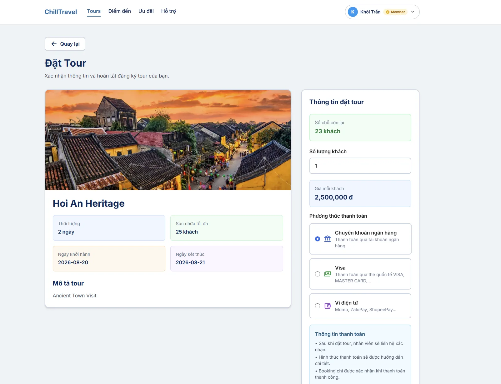
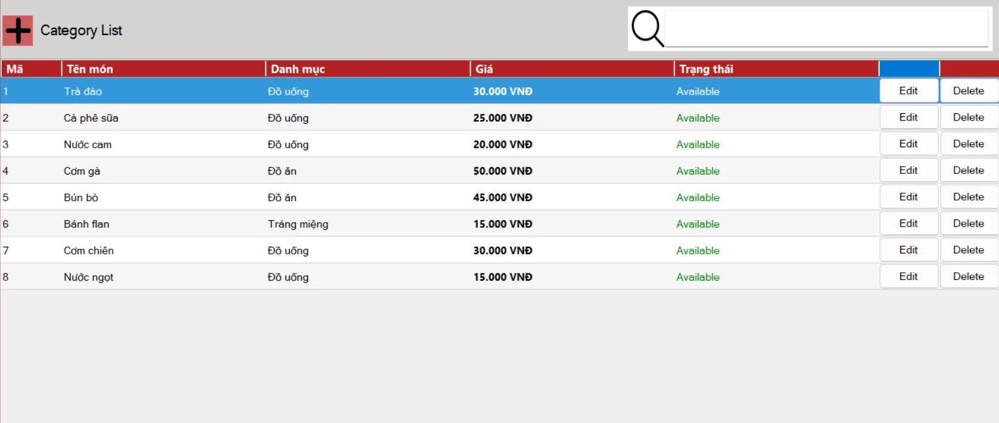

# Tran Quoc Duy Khoi — Developer Portfolio

  <h3>Java Backend Developer Intern</h3>
  
Final-year IT student at the <strong>University of Economics and Finance (UEF)</strong>, focused on Java backend development, Spring MVC and relational database design.

  

    
    
    
  

  

    
    
    
    
    
    
    
    
  

---

## Career Objective

Looking for a **full-time Java Backend internship** where I can build production-grade services with Spring Boot, while strengthening my skills in Java, Spring and database design.

---

## Technical Skills

| Domain | Technologies |
|:---|:---|
| **Languages** | Java (OOP, Collections, exception handling), C#, SQL |
| **Backend & Web** | Spring MVC, Spring Boot, JPA / Hibernate, Servlet & JSP |
| **Architecture** | MVC, Layered (Controller – Service – DAO), Database Design |
| **Databases** | MySQL, Microsoft SQL Server, JOINs, Transactions, PK/FK constraints, parameterized queries |
| **Tools** | Maven, Git, GitHub, NetBeans, Visual Studio, EPPlus |
| **English** | VSTEP 7.0/10 (CEFR B2, 2026) • IELTS 5.5 (2022) |

---

## Featured Projects

### 1. VoyagerElite — Travel Tour Booking System
> **Academic group project** • Role: *Booking & Payment Module Developer*\
> **Source code:** [vannld23/travel-tour-booking-system](https://github.com/vannld23/travel-tour-booking-system)

  

- **Tech stack:** Java, Spring MVC, Servlet & JSP, MySQL, Maven — layered MVC architecture.
- **Key contributions:**
  - Built the booking flow: tour date selection, traveler count, total price calculation and booking creation.
  - Wrapped booking and payment creation in a single database transaction with rollback on failure.
  - Prevented overbooking by checking remaining tour capacity and releasing seats on cancellation.
  - Enforced the booking lifecycle (`Pending → Confirmed → Completed / Cancelled`), rejecting invalid transitions.
  - Recorded payments with method (Bank Transfer, Visa card, E-wallet) and status — no external payment gateway — plus server-side input validation.
  - Designed the MySQL schema with primary/foreign keys and cascade rules.

---

### 2. The Chill Rest. — Restaurant Management App
> **Academic group project** • Role: *Database Design, Menu Management & Revenue Report*\
> **Source code:** [DuyKhoi282/Restaurant-App](https://github.com/DuyKhoi282/Restaurant-App)

  

- **Tech stack:** C#, WinForms, Microsoft SQL Server, EPPlus.
- **Key contributions:**
  - Designed the SQL Server schema with PK/FK constraints and test datasets.
  - Developed Menu Management with full CRUD for dishes and categories.
  - Implemented accent-insensitive search via SQL collation (`Latin1_General_CI_AI`) and parameterized queries against SQL Injection.
  - Built safe-deletion logic that blocks deleting dishes referenced by unpaid orders.
  - Built the Revenue Report: date-range SUM/COUNT aggregation and Excel export with EPPlus.

---

## Education & Achievements

- **University of Economics and Finance (UEF)** — Bachelor of Information Technology (2023 – expected 2027)
- **Consolation Prize** — Cybernet Competition 2025 (CTF-style cybersecurity contest, UEF)
- **VSTEP 7.0/10** (CEFR B2, 2026) • **IELTS 5.5** (2022)

---

## Reference

- **Dr. Hoang Van Hieu** — Lecturer, Faculty of Information Technology, UEF — [hieuhv@uef.edu.vn](mailto:hieuhv@uef.edu.vn)

---

## Contact

- **Phone:** [0929 648 427](tel:0929648427)
- **Email:** [tranquocduykhoi@gmail.com](mailto:tranquocduykhoi@gmail.com)
- **GitHub:** [@DuyKhoi282](https://github.com/DuyKhoi282)
- **Portfolio:** [duykhoi-portfolio.netlify.app](https://duykhoi-portfolio.netlify.app/)
